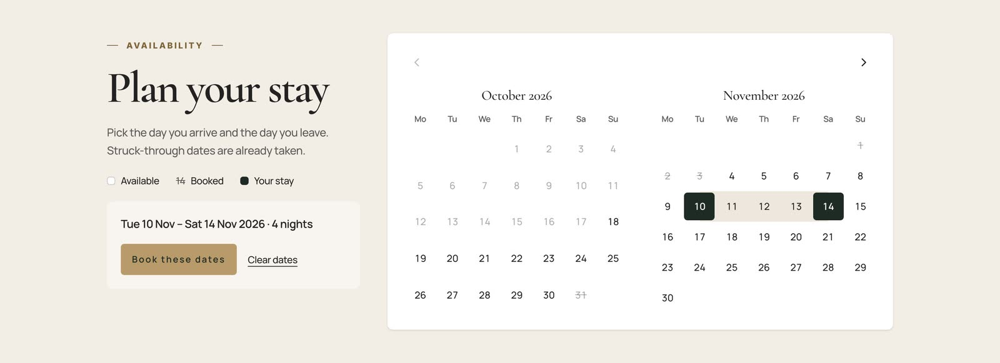
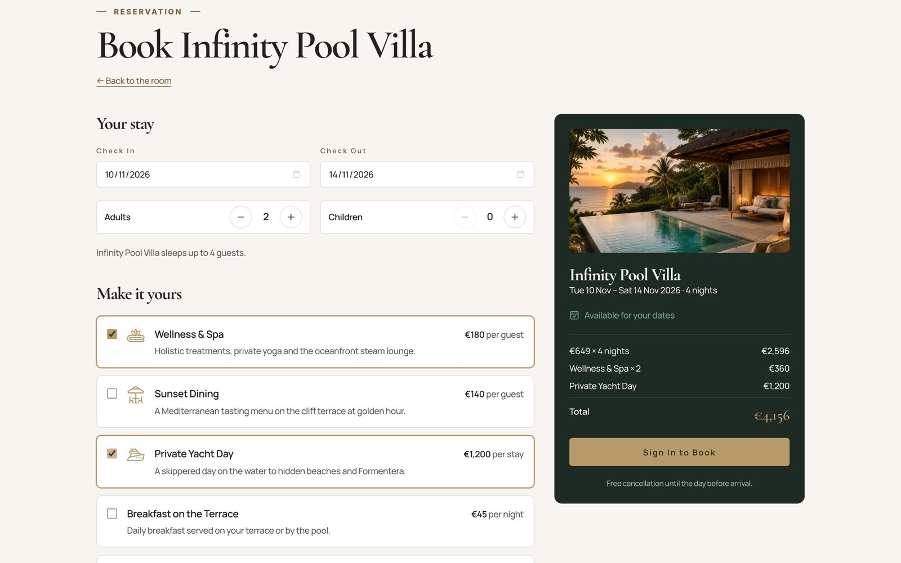
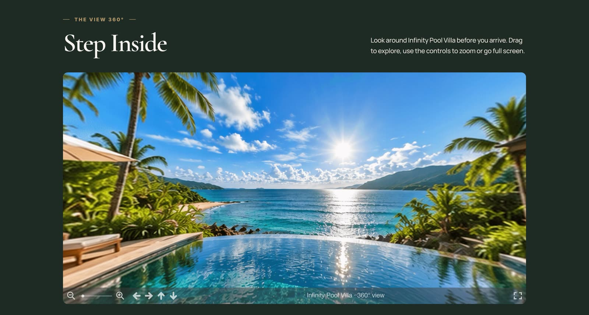
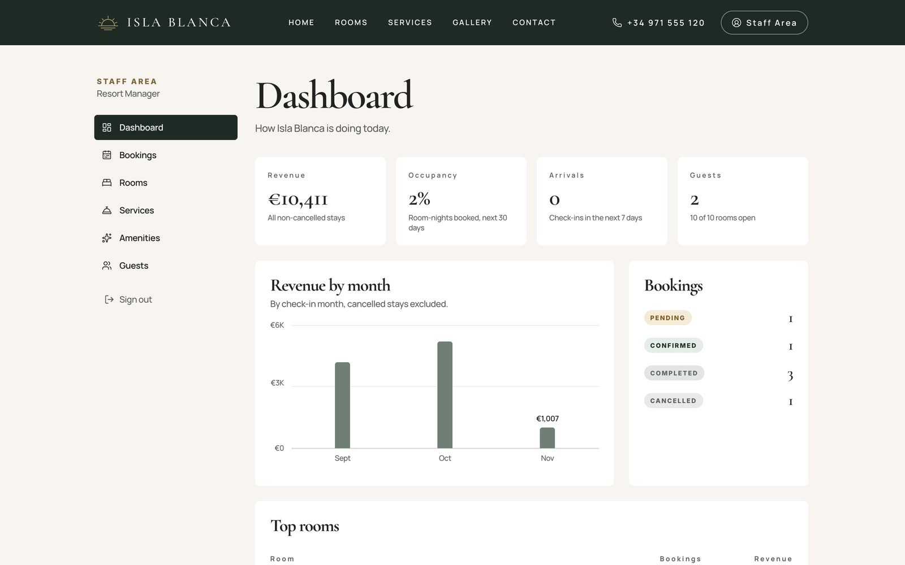
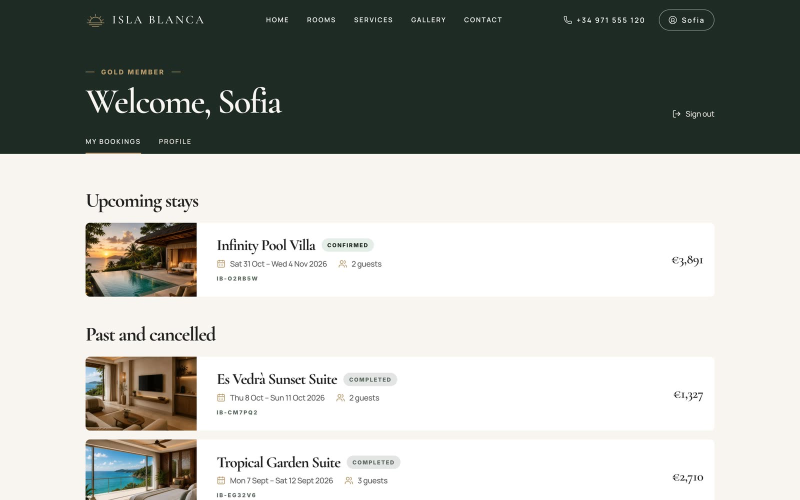
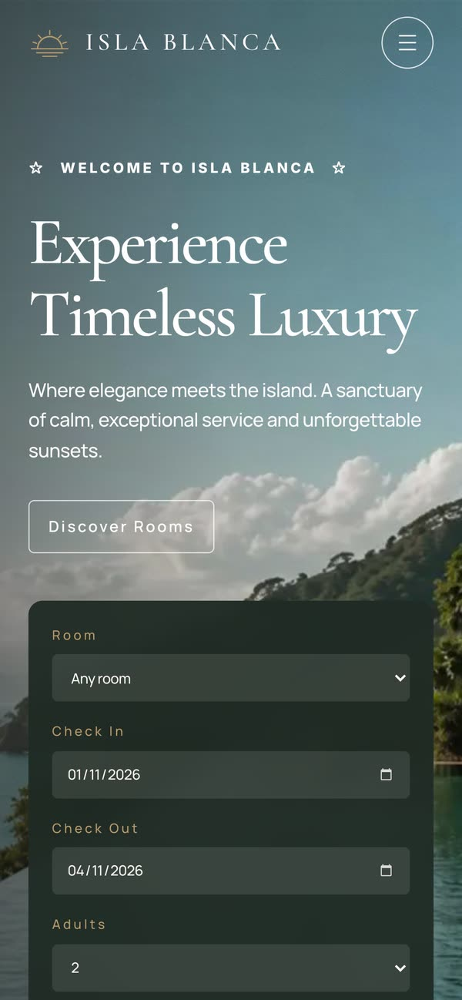
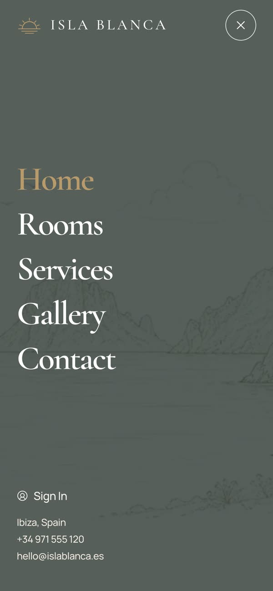
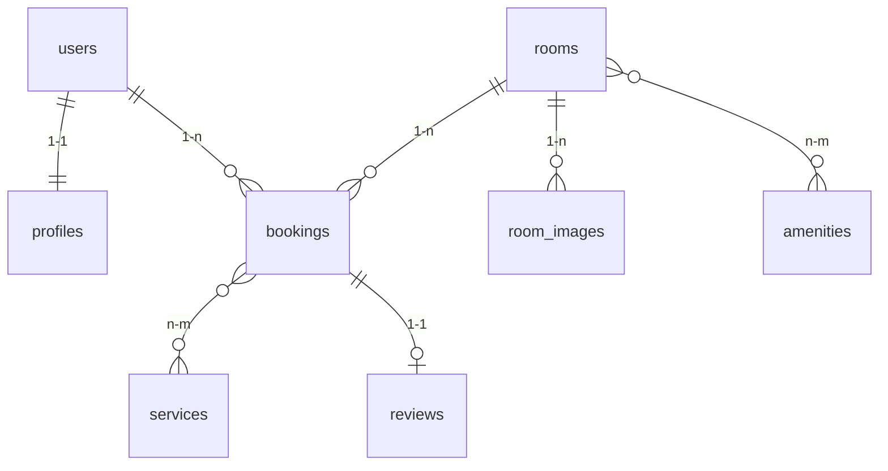

<div align="center">


**A booking platform for a small luxury resort in Ibiza, the island the locals call la Isla Blanca.**

Guests browse suites and villas, see which nights are still free, price their stay with extras
and book it. Staff run the resort from a dashboard: bookings, rooms, prices, services and guests.

<a href="https://andrewtechtips.github.io/isla-blanca/"><strong>Visit the live site</strong></a>
&nbsp;·&nbsp;
<a href="https://isla-blanca-api.onrender.com/docs">API docs</a>
&nbsp;·&nbsp;
<a href="#-run-it">Run it locally</a>

<br /><br />

[](#%EF%B8%8F-built-with)
[](#%EF%B8%8F-built-with)
[](#%EF%B8%8F-built-with)
[](#%EF%B8%8F-built-with)
[](#%EF%B8%8F-the-data-model)
[](#-run-it)

[](https://github.com/AndrewTechTips/isla-blanca/actions/workflows/ci.yml)
[](https://github.com/AndrewTechTips/isla-blanca/actions/workflows/pages.yml)
[](https://isla-blanca-api.onrender.com/api/v1/health)
[](docs/deployment.md)
[](docs/frontend.md#accessibility)

</div>

<br />

<p align="center">
  
</p>

---

## 🌴 What it does

**For guests**

- **See what's free before you fall for a room.** Every room page has a two-month calendar with
  booked nights struck through. Pick an arrival and a departure, and the stay carries straight
  into the booking page.
- **Know the price as you build the stay.** Add a spa day, sunset dinner or a yacht trip and the
  total updates live, priced by the API, never guessed by the browser.
- **Look around first.** The villa has a 360° tour you can drag, zoom and open full screen.
- **Keep it all in one place.** My bookings, cancellations up to the day before arrival, and a
  review once the stay is over.

**For staff**

- A dashboard with revenue by month, occupancy and the next arrivals.
- Bookings to confirm, complete or cancel, and rooms, prices, extras and amenities to edit,
  all reflected on the public site straight away.

## 📸 A look at it

<table>
<tr>
<td width="50%" valign="top"><br /><sub>Booked nights are struck through. A stay can end the morning someone else arrives.</sub></td>
<td width="50%" valign="top"><br /><sub>Extras priced per guest, per night or per stay, totalled as you click.</sub></td>
</tr>
<tr>
<td valign="top"><br /><sub>The 360° tour. The viewer (three.js) only downloads when you press start.</sub></td>
<td valign="top"><br /><sub>The staff dashboard.</sub></td>
</tr>
<tr>
<td valign="top"><br /><sub>A guest's account: upcoming stays first, then the past ones.</sub></td>
<td align="center" valign="top">&nbsp;&nbsp;<br /><sub>On a phone.</sub></td>
</tr>
</table>

## 🧠 Under the hood

- **Double bookings are impossible, not just unlikely.** Overlapping stays are blocked by a
  PostgreSQL exclusion constraint on the date range, so two guests pressing *Book* for the same
  night at the same moment can't both win. The loser gets a clear "already booked" message.
- **Prices are frozen at booking time.** Each extra on a booking keeps the price it had that day,
  so a new price list never rewrites an old invoice.
- **Typed from the database to the button.** The frontend's API types are generated from the
  OpenAPI schema, so a backend change that breaks the site fails the type check, not the guest.
- **The server looks after itself.** On every start the API container runs its migrations and,
  on an empty database, loads the demo resort.
- **Built to be used by everyone.** Keyboard-friendly calendar, focus that never gets lost in
  dialogs, AA contrast, "reduce motion" respected everywhere. Lighthouse accessibility is 100 on
  every page.
- **Light on the wire.** Pages load on demand, photos come as WebP sized to the screen, and the
  heavy 360° viewer waits until it's asked for.

## 🗂️ The data model



<sub>The full diagram, with every column and constraint, is in [docs/database.md](docs/database.md).</sub>

## 🛠️ Built with

| | |
|---|---|
| **Frontend** | React 19 · TypeScript · Vite · React Router · TanStack Query · Tailwind CSS 4 · Motion · Lenis · Photo Sphere Viewer |
| **Backend** | Python 3.13 · FastAPI · SQLAlchemy 2 · Alembic · Pydantic · JWT + Argon2 · uv |
| **Database** | PostgreSQL 18, with exclusion and check constraints doing the hard rules |
| **Quality** | 78 pytest tests against a real PostgreSQL · 31 Vitest tests · Ruff · oxlint · Prettier · CI on every push |
| **Shipped** | Docker · GitHub Actions · GitHub Pages (site) · Render (API) · Neon (database) |

## 🚀 Run it

Everything in containers, nothing to install but Docker:

```bash
cp .env.example .env
docker compose up --build
```

Then open <http://localhost:8080>. The API and its docs are on <http://localhost:8000/docs>.

<details>
<summary><strong>Developing with live reload</strong></summary>
<br />

Needs Docker, [uv](https://docs.astral.sh/uv/) and Node.js 22+.

```bash
cp .env.example .env
docker compose up -d db              # PostgreSQL on localhost:5433

cd backend
uv sync
uv run alembic upgrade head
uv run python -m app.db.seed         # the demo resort
uv run fastapi dev app/main.py       # http://localhost:8000
```

In a second terminal:

```bash
cd frontend
npm install
npm run dev                          # http://localhost:5173
```

Tests: `uv run pytest` in `backend/`, `npm test` in `frontend/`.

</details>

**Demo accounts**

| Who | Email |
|---|---|
| Staff | `admin@islablanca.test` |
| Guest with past and upcoming stays | `sofia.carter@islablanca.test` |
| Guest | `daniel.morgan@islablanca.test` |

<sub>Local passwords are in `.env.example`. The live site uses its own, set when it was deployed.
The free API server sleeps when idle, so the first request after a while can take about a minute.</sub>

## 📚 Docs

[Deployment](docs/deployment.md) · [API](docs/api.md) · [Database](docs/database.md) ·
[Frontend](docs/frontend.md) · [Design](docs/design-spec.md) · [Images and media](docs/assets.md)

---

## 📬 Let's connect

<div align="center">

**Andrei Condrea**

[](https://www.linkedin.com/in/andrei-condrea-b32148346)
[](mailto:condrea.andrey777@gmail.com)

</div>


