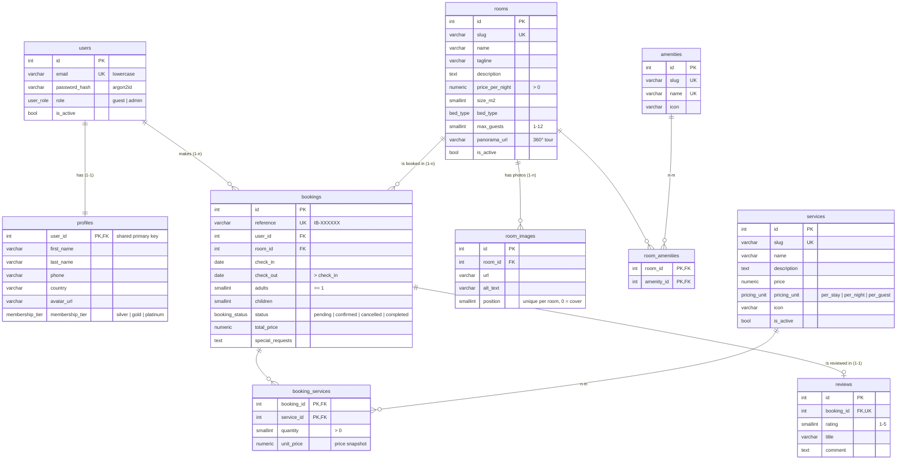

# Database

PostgreSQL 18, accessed through SQLAlchemy 2 and versioned with Alembic migrations
(`backend/alembic/versions/`). Ten tables:

Every table except the two link tables and `room_images` also has `created_at` and
`updated_at` (`timestamptz`).

## Relations

| Type | Where | How it is enforced |
|---|---|---|
| **1-1** | `users` ↔ `profiles` | `profiles.user_id` is both primary key and foreign key, so a second profile for the same user is impossible. Deleting a user deletes the profile (`ON DELETE CASCADE`). |
| **1-1** | `bookings` ↔ `reviews` | `reviews.booking_id` is `UNIQUE`: one review per stay, only for real stays. |
| **1-n** | `users` → `bookings`, `rooms` → `bookings` | `ON DELETE RESTRICT`: a user or a room with bookings can't be deleted, the booking history stays intact. |
| **1-n** | `rooms` → `room_images` | Ordered by `position`; photos are deleted with the room. |
| **n-m** | `rooms` ↔ `amenities` | Pure link table `room_amenities` with a composite primary key. |
| **n-m** | `bookings` ↔ `services` | Association table `booking_services` that carries its own data: `quantity` and `unit_price` (the price at booking time, so later price changes never alter past bookings). |

## Rules enforced by the database

- **No double bookings.** An exclusion constraint (`ex_bookings_no_overlapping_stays`, GiST
  index via the `btree_gist` extension) rejects two active bookings of the same room with
  overlapping `[check_in, check_out)` ranges. Cancelled bookings don't count, and the checkout
  day is free for the next guest.
- Check constraints for every numeric rule: positive prices, `check_out > check_in`, at least
  one adult, rating between 1 and 5, quantity above zero.
- Emails are unique and stored lowercase.
- Native PostgreSQL enums for roles, membership tiers, bed types, booking statuses and pricing
  units.
- Deterministic constraint names (`pk_`, `fk_`, `uq_`, `ck_`, `ix_` prefixes), so migrations are
  readable and errors point to the exact rule that failed.

## Demo data

`uv run python -m app.db.seed` (or `--reset`) creates 10 rooms with 24 photos, 8 amenities,
5 services, an admin and two guests with profiles, and 6 bookings (completed with and without
a review, confirmed, pending and cancelled) with dates relative to the day the seed runs. Demo
credentials come from `.env` (see `.env.example`).
